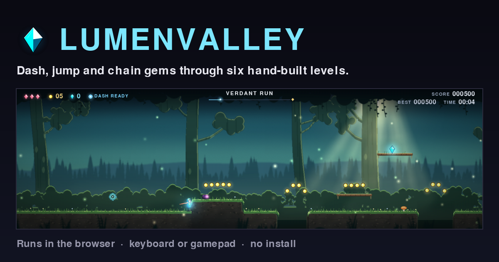

# Lumenvalley

**[▶ Play Lumenvalley in your browser](https://iams1am.github.io/LUMENVALLEY/)** — no install, no account.



Lumenvalley is a painterly 2D platformer. You are the Wayfarer, a hooded
traveller whose crystal pendant lights the way through five backlit worlds: a
misty forest of giant trunks, blue caverns of crystal and lava, a citadel above
a sea of cloud, moonlit obsidian spires and an amber clockwork vault.

Everything you see and hear is made in code — layered parallax, light shafts
and drifting mist, organic terrain, the hero and every enemy, the music and the
sound effects. The game is written in Python with pygame-ce and runs in the
browser as WebAssembly, built with pygbag.

## How to play

The first visit downloads a ~10 MB runtime (about 10–20 s on a cold cache, a
few seconds after that). When the page says **One click to start**, click once:
browsers need a click before a game may start its audio.

| Action | Keys |
|---|---|
| Move | ← / → or A / D |
| Jump (hold for height, bounce off enemies) | Space, ↑ or W |
| Dash | X or L |
| Pause / back | Esc |
| Restart the level | R |
| Sound on / off | M |
| Menus | ↑ / ↓ to choose, Enter to confirm |

A gamepad works too. The bar above the game has **Fullscreen**, **Sound**,
**Controls**, **Save data** and **Load data**; progress is kept in your
browser, and Save data downloads it as a file.

## What's in the game

- Six levels across five worlds — Verdant Run, Crystal Caverns, Skyfall
  Citadel, Obsidian Spire, Night Throne and Clockwork Vault
- A dash that chains through prism rings, springs, one-way platforms, spikes
  and lava, several enemy types and a boss
- Checkpoints, medals and pace lines, 12 optional challenges, 8 achievements,
  time trials and a hard mode
- A built-in level editor: E / Q pick a tile, N changes the world, Space
  paints, X erases, V saves, Enter test-plays

## Host your own copy

This repository contains exactly what GitHub Pages needs to build and serve
the game. `.github/workflows/pages.yml` installs Python 3.12, `pygame-ce 2.5.8`
and `pygbag 0.9.3`, builds the site with `tools/build_web.py` and deploys it on
every push to `main`.

1. Fork the repository.
2. In **Settings → Pages**, set **Source** to **GitHub Actions**.
3. Run the **Deploy web build to Pages** workflow, or push to `main`.

To build and serve it on your own machine (Python 3.12):

```bash
pip install pygame-ce==2.5.8 pygbag==0.9.3
python tools/build_web.py --serve        # then open http://localhost:8080/
```

pygbag output has to be served over HTTP; opening `index.html` straight from
disk does not work.

## What's where

| Path | What it is |
|---|---|
| `lumenvalley/` | The game core — simulation, physics, enemies, progression, UI layout — and the painted renderer in `lumenvalley/rendering/` |
| `pygame_view.py` | The front-end the browser runs: drawing, audio and input |
| `game.py`, `entities.py`, `levels.py`, … | Levels, entities, audio, saves and the shared game facade |
| `web/` | Browser entry point, save adapter, page shell, pygbag template, icon and link preview |
| `assets/` | Font, music and sound effects |
| `tools/build_web.py` | Stages the runtime files and builds the static site |

## Credit and license

Lumenvalley © 2026 Siam ([iams1am](https://github.com/iams1am)).

Licensed under [Creative Commons Attribution 4.0 (CC BY 4.0)](LICENSE). You may
share, change and build on the game for any purpose, including commercially,
**as long as you credit the author and the game**, link to the license and say
what you changed. Credit it like this:

> "Lumenvalley" by Siam (iams1am) — https://github.com/iams1am/LUMENVALLEY — CC BY 4.0

Third-party parts keep their own licenses: the GNU FreeFont typeface
(`assets/fonts`, GPLv3 with the font exception) and the pygbag page template
(MIT). Both notices are in [NOTICE](NOTICE).
